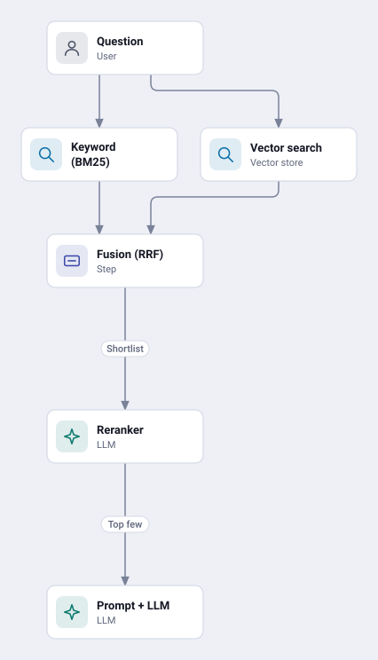
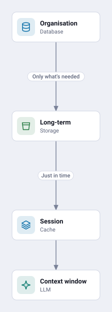
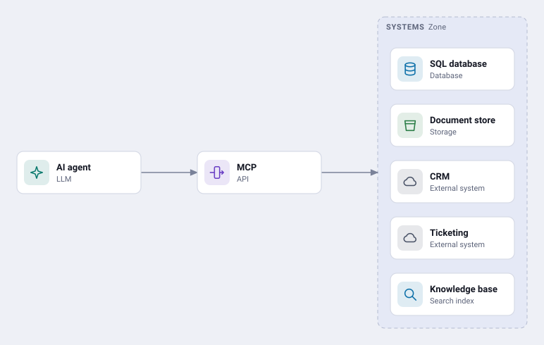

Ask a capable model about your leave policy and it will answer fluently and wrongly. It has read a large slice of the internet, but it has never seen your contracts, your HR site or last week's meeting notes. Everything an agent does well inside an organisation depends on how it gets hold of that knowledge.

**The short version:** the model never searches. Your system finds the few pieces of knowledge that matter at question time and hands them over. This is called *grounding*, and retrieval quality decides answer quality.
{: .notice--info}

The whole storyline in under two minutes, before the detail:

<video controls muted playsinline preload="metadata" poster="/assets/images/posts/2026/11/knowledge-in-agentic-apps/storyline-poster.jpg" style="display:block;width:100%;aspect-ratio:16/9;border-radius:8px;box-shadow:0 2px 12px rgba(0,0,0,0.25);background:#0d1324;">
  <source src="/assets/images/posts/2026/11/knowledge-in-agentic-apps/storyline.webm" type="video/webm">
  <source src="/assets/images/posts/2026/11/knowledge-in-agentic-apps/storyline.mp4" type="video/mp4">
  Your browser cannot play this video. <a href="/assets/images/posts/2026/11/knowledge-in-agentic-apps/storyline.html">Open the step-by-step version</a>.
</video>

[Step through it at your own pace](/assets/images/posts/2026/11/knowledge-in-agentic-apps/storyline.html){: .btn .btn--inverse}

---

## The problem: a model knows the world, not your organisation

Think of a brilliant new hire who has read every public book but has not yet been given a login. They can reason about anything you put in front of them, but they cannot answer a question about your business until someone hands them the right file. There are three reasons the model cannot simply know your data:

| Problem | Why |
|---------|-----|
| **Private** | Your contracts, emails and meeting notes were never in its training data. |
| **Stale** | Training stops at a cutoff date. Your data changes every hour. |
| **Too big** | Millions of documents will never fit into a context window at once. |

The fix is the same in every case: find the few pieces that matter when the question is asked and give them to the model. Every technique below is a different answer to one question: how do we get the right slice of knowledge into the model at the right moment?

### Six generations, stacked rather than replaced

| # | Generation | The idea |
|---|------------|----------|
| 01 | Keyword search | Match exact words (BM25). Fast, but misses synonyms. |
| 02 | Vector RAG | Turn text into meaning vectors; paste the closest chunks into the prompt. |
| 03 | Hybrid + rerank | Combine keyword and vector results, then re-score the best. |
| 04 | GraphRAG | Add entities and relationships for multi-hop questions. |
| 05 | Agentic retrieval | The model plans, searches several sources, checks, and retries. |
| 06 | Memory + MCP | Persistent memory, plus standard plugs into any system. |

Newer generations do not replace older ones. Production systems stack 03 to 06: hybrid search underneath, graphs and agentic planning on top, memory around it all.

---

## 1. Retrieval-augmented generation

RAG runs as two loops. Offline, you build the index once and refresh it often. Online, every question runs a search against that index and the best few chunks go into the prompt.

{: style="display:block;margin:0 auto;max-width:420px"}

The key insight is in the middle of the online loop: **the model never searches.** Your code retrieves; the model only reads what it is handed. Bad retrieval means bad answers, however good the model.

Chunking matters more than it looks. Split on headings and sections so each chunk carries a complete thought, and keep the document title and metadata attached to it.

### Embeddings: meaning becomes coordinates

An embedding model turns each chunk into a long list of numbers, and similar meanings land close together. "How many days off do I get?" lands beside the leave-policy chunks without sharing a single keyword with them. Vector search simply finds the nearest neighbours to the question. Real embeddings have hundreds or thousands of dimensions, but the picture to hold is a map where related ideas sit in the same neighbourhood.

---

## 2. Hybrid search: two searches, one ranked shortlist

Vector search is good at paraphrase and poor at exact strings. Ask for invoice `INV-2231` and the nearest meaning may be a different invoice. So the default is to run both and merge them.

{: style="display:block;margin:0 auto;max-width:480px"}

- **Keyword (BM25)** catches exact words, codes and names.
- **Vector** catches meaning and paraphrase: "money we owe the supplier".
- **Fusion**, typically Reciprocal Rank Fusion, merges the two ranked lists.
- **A reranker**, a second model, re-reads each shortlisted chunk against the question and re-scores it.

Only the top few go to the model: a small, highly relevant context. This combination is what mainstream search engines and most vector databases now offer out of the box, which is why it is the sensible default.

---

## 3. Knowledge graphs: relationships answer what similarity can't

"Which supplier contracts affect projects Priya leads?" is not a similarity question. No single chunk contains the answer; it sits in the links between a person, a project, a contract and a supplier. Vector search finds look-alike text. A graph follows the links, hop by hop. Press play to follow the question through the graph:



- A **knowledge graph** stores entities and relationships explicitly and is queried by traversal.
- **GraphRAG** has a model extract the graph from documents, then summarises clusters of related entities so it can answer "big picture" questions, such as which themes recur across every customer call.

---

## 4. Agentic retrieval: retrieval becomes a reasoning loop

Single-shot RAG struggles when a question is ambiguous, multi-step, or spans several systems. Agentic retrieval hands the search strategy to the model: it plans, searches, checks whether it has enough evidence, and loops back if not. Step through one question to see the loop at work:



This is the same split I described in [the orchestration patterns post](/concepts/ai/architecture/agentic-orchestration-patterns/): plain RAG is a workflow, where code decides the steps; agentic retrieval is an agent, where the model does. It buys better answers to hard questions at the cost of latency and tokens on every one.

---

## 5. Memory: four timescales

An agent's knowledge is not all equal. It lives at four timescales, from permanent and cheap to momentary and expensive.

{: style="display:block;margin:0 auto;max-width:380px"}

| Layer | What it holds | Lasts |
|-------|---------------|-------|
| **Organisational knowledge** | Indexes, graphs and systems of record, shared and governed | Permanent |
| **Long-term memory** | Facts and preferences the agent saves about a user | Across chats |
| **Session memory** | The conversation so far, summarised when it grows long | One chat |
| **Working memory** | The context window: this prompt, retrieved chunks, tool results | One model call |

The context window is tiny and expensive; organisational knowledge is huge and cheap. Good agents move only what is needed upward, just in time. This discipline is now often called *context engineering*: deciding deliberately what reaches the context window, and when.

---

## 6. Tools and MCP: one standard plug

Without a standard, every agent needs custom glue for every system, so integrations multiply as agents times systems. The [Model Context Protocol](https://modelcontextprotocol.io/) gives each system one server that any compliant agent can use.

Two things follow. A whole retrieval pipeline, hybrid search and reranker included, can appear to an agent as a single tool. And an agent can query a system in place over MCP rather than copying its data into an index first, which suits data that changes too fast to re-index. I compared MCP with agent skills in [an earlier post in this series](/concepts/fundamentals/ai/ml/agentic-connectivity-mcp-vs-agent-skills/).

---

## Choosing between them

| Approach | Best for | Weak at | Cost |
|----------|----------|---------|------|
| **Vector RAG** | Fuzzy "what does our policy say about…" questions | Exact codes, names and numbers | Low |
| **Hybrid + rerank** | Most enterprise search: the sensible default | Questions spanning many documents | Low to medium |
| **GraphRAG** | Multi-hop links and themes across a whole corpus | Fast-changing data; keeping the graph current | High to build |
| **Agentic retrieval** | Complex, multi-part questions across sources | Latency and token cost per question | Medium to high per query |

Or, starting from the question:

| If the question sounds like… | Reach for |
|------------------------------|-----------|
| "What does the travel policy say about hotels?" | Hybrid RAG |
| "Find invoice INV-2231" | Keyword (inside hybrid) |
| "Which suppliers link to projects Priya leads?" | Knowledge graph |
| "What themes recur across all customer calls?" | GraphRAG summaries |
| "Compare UK and India policies, then draft an update" | Agentic retrieval |
| "Remember I prefer answers as tables" | Long-term memory |

Some managed search services now expose agentic retrieval as a dial rather than a switch: a minimal setting that runs direct keyword and vector searches, a default that adds one pass of planning, and a higher one that iterates when the first results are not good enough. That is the table above, turned into a per-query cost setting.

---

## The reference architecture

Strip away the product names and every knowledge stack has the same five layers.

{: style="display:block;margin:0 auto;max-width:380px"}

| Layer | What happens |
|-------|--------------|
| **Sources** | Files, email and chat, CRM, ERP, tickets, databases and APIs |
| **Ingest** | Parse and OCR, chunk by structure, enrich metadata, embed |
| **Store** | Vector index, keyword index, knowledge graph, memory store |
| **Retrieve** | Hybrid search, reranker, graph traversal, agentic planner |
| **Reason and act** | Model and prompt, tools via MCP, citations, guardrails |

Across every layer: identity and permission trimming, evaluation (recall and groundedness), observability, and data governance.

### Six habits of production-grade apps

1. **Trim by permission at query time.** Filter results by the user's identity before the model sees them. Whatever a user can find, the agent can surface, so oversharing in the source becomes over-surfacing in the answer.
2. **Chunk with structure.** Split on headings and sections; keep titles and metadata with each chunk.
3. **Default to hybrid plus rerank.** Add graphs or agentic loops only when the questions demand it.
4. **Always cite sources.** Citations let users verify answers and expose bad retrieval quickly.
5. **Evaluate continuously.** Keep test sets that score retrieval recall, groundedness and answer quality.
6. **Fix data hygiene first.** Stale and overshared content become wrong answers. Clean before you index.

---

## Conclusion

An agent is only as good as what it is given to read. The model reasons; your system decides what it gets to reason about.

- **Retrieval quality decides answer quality.** The model never searches; your code does.
- **Hybrid search with reranking is the default.** Graphs and agentic loops are upgrades for harder questions, and they cost more.
- **Memory is layered.** Move only what is needed into the context window, just in time.
- **Connect once, through a standard.** MCP turns every system, and every retrieval pipeline, into a tool any agent can use.
- **Clean, well-permissioned data comes first.** No retrieval pattern fixes content that is stale or shared with the wrong people.
